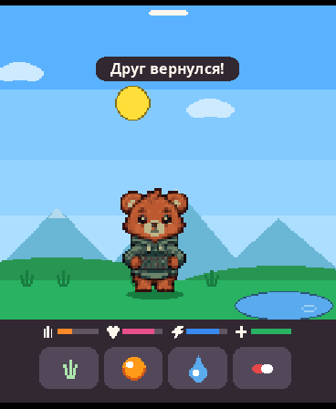
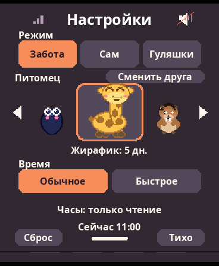
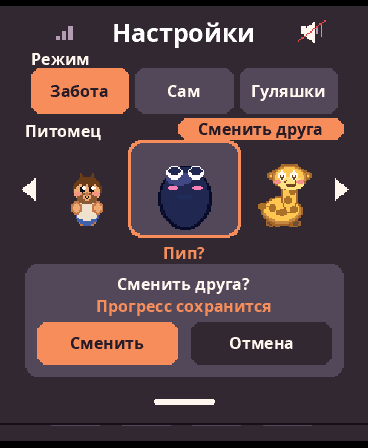
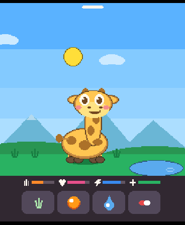
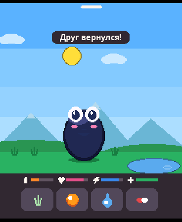

<h1 align="center">MedveGoshi</h1>
<p align="center">
  <strong>Карманный электронный питомец на ESP32-S3</strong><br>
  Русскоязычная ветка проекта Capigoshi: игры, сенсорное управление, звук, привычки и маленькая обучаемая нейросеть.
</p>
<p align="center">
  <a href="README.en.md">English</a> ·
  <a href="#скриншоты">Скриншоты</a> ·
  <a href="#что-уже-работает">Возможности</a> ·
  <a href="#оборудование-и-совместимость">Платы</a> ·
  <a href="#установка-на-оригинальную-плату">Установка</a> ·
  <a href="CODEMAP.md">Карта исходников</a> ·
  <a href="CONTRIBUTING.md">Участие</a> ·
  <a href="CREDITOS.md">Благодарности и лицензии</a>
</p>

> **Статус:** здесь собрана русская версия с 13 питомцами и экспериментальным портом AMOLED 1.8 V1. Изменения пока в [PR #2](https://github.com/Medvedolog/medvegoshi/pull/2); по умолчанию репозиторий открывает `main` с оригинальной Capigoshi для IPS 1,83″. Порт V1 ещё не проверен на физической плате; автоустановка V1 отключена. Не прошивайте AMOLED образом IPS.

## Русский интерфейс

<p align="center">
  <a href="docs/img/medvegoshi-ru/bjorni-care.png"></a>
  <a href="docs/img/medvegoshi-ru/settings-modes.png"></a>
  <a href="docs/img/medvegoshi-ru/switch-confirm.png"></a>
  <a href="docs/img/medvegoshi-ru/girafa-care.png"></a>
  <a href="docs/img/medvegoshi-ru/pip-care.png"></a>
</p>

*Скриншоты из эмулятора AMOLED V1 (368×448), с русской прошивкой из [PR #2](https://github.com/Medvedolog/medvegoshi/pull/2). Это не фотографии устройства.*

## Скриншоты

**[Полная галерея: все 13 питомцев](docs/SCREENSHOTS_RU.md).** В галерее есть дневные и ночные сцены, прогулки и русские реплики. Открой картинку, чтобы увидеть интерфейс в полном размере.

**Бйорни** — медвежонок-программист. Он печатает на клавиатуре, бегает в обе стороны, прыгает и радуется. Для игры добавлены отдельные позы сна, голода, кормления, болезни и испуга.

В русской версии переведены игровое меню, выбор питомца, настройки часов и звука, подсказки и реплики. Три режима: **«Забота»** — кормить, лечить и играть; **«Сам»** — питомец сам решает, чем заняться; **«Гуляшки»** — бегать, прыгать и собирать монеты.

На **AMOLED V1** меню настроек рисуется в родном разрешении пропорциональным **Noto Sans Bold** без засечек: буквы держат общую базовую линию, края сглажены, а цифры одинаковой ширины, чтобы часы не «прыгали». Глифы хранятся в компактном растровом виде, TTF на устройство не нужен. На **IPS** для кириллицы используется компактный растровый шрифт на основе **DejaVu Sans Mono**. [Шрифт AMOLED и лицензия OFL](https://github.com/Medvedolog/medvegoshi/blob/feature/russian-game-ui/ports/v1_menu_font.py) · [Лицензия шрифта IPS](https://github.com/Medvedolog/medvegoshi/blob/feature/russian-game-ui/docs/FONT_LICENSE.md).

### 13 питомцев

Десять из Capigoshi: **Капи, Слон, Утка, Осьминог, Попугай, Карамелька, Кот, Пришелец, Лягушонок и Робинзон**. В MedveGoshi к ним добавились **Пип, Жирафик и Бйорни**. У каждого своё сохранение: можно сменить питомца, а потом вернуться к прежнему прогрессу. Новые персонажи подключаются через [модульный каталог Zoo](https://github.com/Medvedolog/medvegoshi/tree/feature/russian-game-ui/zoo).

## Откуда проект

**Спасибо автору [Capigoshi — rjcaubit](https://github.com/rjcaubit/capigoshi)** и Жуану (João), придумавшему и нарисовавшему первых персонажей в девятилетнем возрасте. Здесь развивается независимая русскоязычная версия **MedveGoshi**, основанная на их работе. Первоначальный код — по [лицензии MIT](LICENSE); условия для оригинальных рисунков и звуков описаны в [благодарностях](CREDITOS.md). Исходный проект и его сайт: [GitHub](https://github.com/rjcaubit/capigoshi) · [capigoshi.mundocapi.com](https://capigoshi.mundocapi.com).

## Что уже работает

**Ниже описаны игровые возможности русской версии. Результаты на физической V1 пока не подтверждены.**

- **Три режима:** уход за питомцем; наблюдение за его самостоятельной жизнью; прогулка с прыжками и сбором монет.
- **Реакции:** поглаживание пальцем, поднятие и перетаскивание, встряхивание, громкие звуки рядом с устройством.
- **Возраст:** яйцо (вылупляется примерно за 10 минут), детство, взросление, старость; завершение цикла и новое яйцо.
- **Поведение:** движения, выражения мордочки, реплики, сон по часам, смена суток и погоды.
- **Нейросеть в режиме «Сам»:** 107 входных сигналов, 96 промежуточных нейронов, 100 возможных действий. Похвала и замечания влияют на привычки. Результат сохраняется в `brain.bin`.
- **Звук:** встроенные короткие эффекты; дополнительные голосовые записи загружаются отдельно.
- **Связь (необязательно):** Wi-Fi для времени и погоды; ESP-NOW для встреч двух устройств и обмена подарками.

### Как играть

| Действие | Результат |
|---|---|
| Потянуть экран вниз от верхней кромки | Открыть меню: режим, персонаж, время, звук |
| Нажать на питомца | Погладить |
| Удержать и переместить пальцем | Поднять и перенести питомца |
| Встряхнуть устройство | Питомец реагирует на движение |
| Нажать на яйцо | Ускорить вылупление на 20 секунд |
| В режиме «Забота» выбрать действие | Покормить, поиграть, искупать или дать лекарство |
| В режиме «Сам» удержать палец на питомце около секунды | Похвалить действие («звезда») |
| В том же режиме удержать палец на фоне | Мягко пожурить («тише») |
| В режиме «Гуляшки» удерживать сторону экрана | Двигаться; короткое нажатие — прыжок; три — автодвижение |
| Удержать BOOT 3 секунды | Настройка Wi-Fi и просмотр состояния «мозга» через телефон |

В штатной прошивке питомец спит примерно **с 22:00 до 06:00**, а звуки отключаются **с 22:00 до 08:00** (по реальным часам). В меню есть ускоренное игровое время: сутки за 30, 15 или 10 минут. В оригинальной прошивке смена персонажа начинает игру заново; в русской версии у каждого питомца отдельное сохранение.

## Оборудование и совместимость

| Плата | Дисплей и сенсор | Состояние |
|---|---|---|
| [Waveshare ESP32-S3-Touch-LCD-1.83](https://www.waveshare.com/wiki/ESP32-S3-Touch-LCD-1.83) | IPS ST7789, 240×284; CST816D | **Оригинальная поддерживаемая аппаратная платформа** |
| [Waveshare ESP32-S3-Touch-AMOLED-1.8 V1](https://www.waveshare.com/esp32-s3-touch-amoled-1.8.htm) | AMOLED SH8601, 368×448; FT3168 | **[Экспериментальная сборка в PR #2](https://github.com/Medvedolog/medvegoshi/pull/2), не проверена на плате** |
| Waveshare ESP32-S3-Touch-AMOLED-1.8 V2 | CO5300; CST820 | Другая ревизия, **не целевая для первого порта** |

Обе платы содержат ESP32-S3, но отличаются экраном, сенсором, электрическими соединениями и деталями инициализации. Драйвер для SH8601 под MicroPython есть в стороннем проекте [dobodu/Lilygo_Waveshare_Amoled_Micropython](https://github.com/dobodu/Lilygo_Waveshare_Amoled_Micropython). **Наличие драйвера не означает готовность порта игры.** Для FT3168, звука, датчиков и питания нужна проверка на физической V1.

Рекомендованы USB-C и аккумулятор с **подходящими разъёмом, полярностью и габаритами**. Наличие аккумулятора зависит от комплектации продавца.

## Установка на оригинальную плату

Команды ниже клонируют оригинальную ветку `main`. Русские изменения находятся в `feature/russian-game-ui` и пока проверены в эмуляторе, а не на физическом устройстве.

Требуются Python 3, `esptool`, `mpremote` и оригинальная **IPS 1,83″**. Для Linux/macOS:

```bash
python3 -m pip install esptool mpremote
git clone https://github.com/Medvedolog/medvegoshi.git
cd medvegoshi
```

Переведите устройство в режим прошивки: удерживайте **BOOT**, кратко нажмите **RST**, отпустите **BOOT**. Затем выполните:

```bash
bash deploy.sh
```

**Внимание: `deploy.sh` полностью стирает Flash**, включая историю питомца и `brain.bin`. Для обновления только файлов на уже работающем устройстве (без стирания данных), используйте:

```bash
bash deploy.sh --so-arquivos
```

В Windows команды из `deploy.sh` можно выполнить вручную. Альтернатива — MicroPython `ESP32_GENERIC_S3-SPIRAM_OCT` с [официального сайта](https://micropython.org/download/ESP32_GENERIC_S3/), далее копирование файлов через `mpremote`. **Не используйте стандартную установку для AMOLED V1 до подготовки отдельного драйвера и конфигурации платы.**

### Звук и подключение

В `sons/` лежат звуковые эффекты, разрешённые для распространения. Дополнительные записи, включая голосовые, берутся с Pixabay по ссылкам из [`sons/pixabay.sh`](sons/pixabay.sh). Их исходные файлы не распространяются вместе с проектом из-за условий лицензии. Без них игра продолжает работать, но без дополнительного голоса.

Для настройки Wi-Fi удерживайте **BOOT 3 секунды**, подключитесь с телефона к сети **Capigoshi** по QR-коду и укажите домашнюю сеть. Для связи двух игрушек интернет не требуется.

## Разработчикам

- [Карта модулей](CODEMAP.md) — где игровая логика, анимации, нейросеть, драйверы и файлы состояния.
- [План переноса на Waveshare AMOLED 1.8 V1](docs/PORT_AMOLED_V1.md) — этапы и критерии проверки, **не готовая прошивка**.
- [План русификации интерфейса](docs/LOCALIZATION_RU.md) — строки, шрифты, реплики и проверка.
- [Участие в проекте](CONTRIBUTING.md) — тесты, проверка графики, правила изменений.
- [Калибровка нейросети](CALIBRACAO.md) — параметры, гипотезы и результаты измерений.
- [Благодарности и лицензии](CREDITOS.md) · [Кодекс поведения](CODE_OF_CONDUCT.md).
- [Английская документация оригинальной версии](README.en.md).

### Ближайшие задачи MedveGoshi

1. Проверить русские тексты, шрифты и зоны касаний на физических экранах.
2. Порт на **Waveshare AMOLED 1.8 V1 (SH8601 + FT3168)** без изменения логики игры.
3. Проверка звука ES8311, микрофона, QMI8658, RTC и AXP2101 на целевой плате.
4. Энергосбережение, пробуждение по кнопке, безопасное сохранение состояния.
5. Дополнительный детский режим — только **после реализации и тестирования**.

### Ограничения

- Это не готовый голосовой ассистент: свободный диалог и распознавание речи в оригинале отсутствуют.
- Оригинальная прошивка в `main` не включает русский интерфейс. Скриншоты показывают отдельную сборку из PR #2.
- «Сон» питомца в оригинале **не равен глубокому сну ESP32**; оценку автономности нужно делать после оптимизации.
- Точный статус аппаратного порта будет обновляться по мере реальных испытаний.

---

**Благодарность оригиналу:** [rjcaubit/capigoshi](https://github.com/rjcaubit/capigoshi) — авторская идея, программная база и персонажи; Жуан (João) — первоначальные рисунки и движения. Спасибо за открытый проект. MedveGoshi — независимое продолжение, не официальный релиз авторов Capigoshi.
