# Скриншоты MedveGoshi

[← На главную](../README.md) · [Бйорни крупным планом](#бйорни-крупным-планом)

Все кадры сняты в эмуляторе **AMOLED V1, 368×448** из русской сборки [PR #2](https://github.com/Medvedolog/medvegoshi/pull/2). Реплики, часы и метки полей набраны пропорциональным Noto Sans Bold в родном разрешении, как и меню. Слева игровой момент, справа тот же питомец в меню «Настройки». Подписи поясняют сцену; реплики в кавычках взяты с экрана. Нажми на кадр, чтобы увеличить.

| Питомец и сцена | В игре | В настройках |
|---|:---:|:---:|
| **1. Капи** Яйцо «Я в яйце!» · «Согрей меня!» | <a href="img/medvegoshi-ru/gallery/capi-play.png">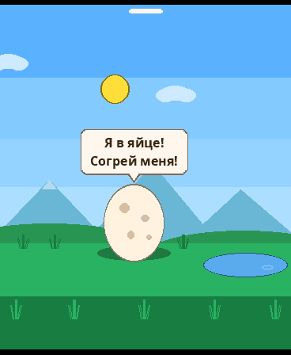</a> |  |
| **2. Слон** Купание «Как приятно!» |  | <a href="img/medvegoshi-ru/gallery/elefante-settings.png">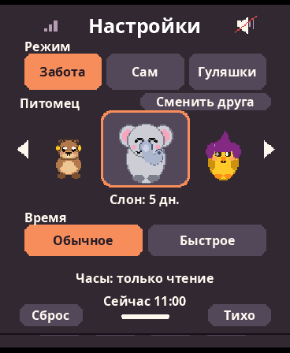</a> |
| **3. Утка** Ночь и сон «Пойду спать...» | <a href="img/medvegoshi-ru/gallery/pato-play.png">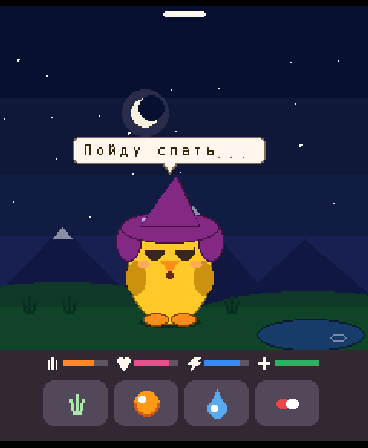</a> | <a href="img/medvegoshi-ru/gallery/pato-settings.png">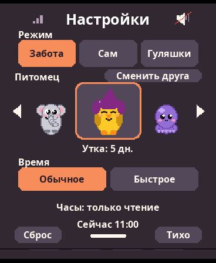</a> |
| **4. Осьминог** Утренняя прогулка «Поле 1» |  | <a href="img/medvegoshi-ru/gallery/polvo-settings.png">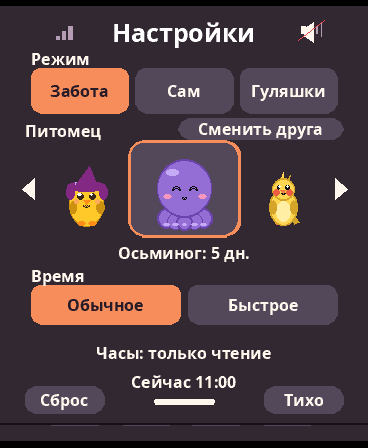</a> |
| **5. Попугай** Осмотр «Я не болею!» |  |  |
| **6. Карамелька** Кормление после обеда «Я уже сыт!» |  | <a href="img/medvegoshi-ru/gallery/cachorro-settings.png">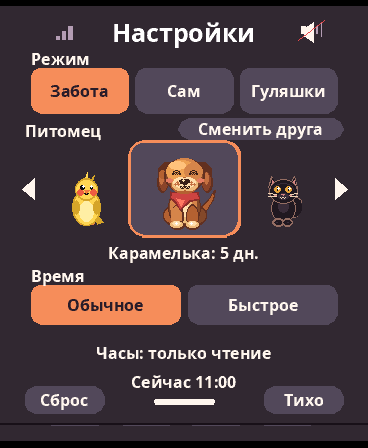</a> |
| **7. Кот** Котёнок «Я не болею!» |  |  |
| **8. Пришелец** Прыжок на прогулке «Поле 1» | <a href="img/medvegoshi-ru/gallery/et-play.png">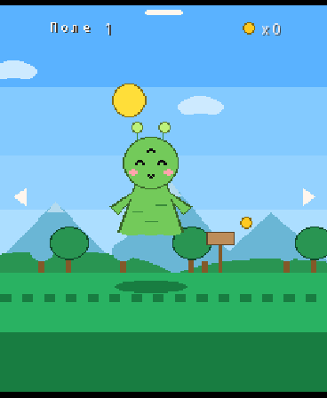</a> | <a href="img/medvegoshi-ru/gallery/et-settings.png">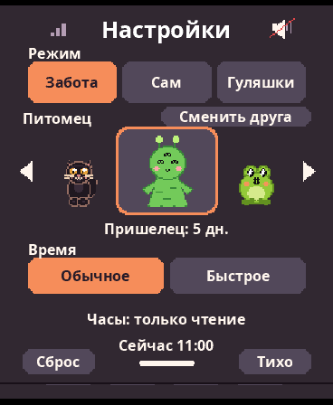</a> |
| **9. Лягушонок** Лекарство «Мне лучше!» | <a href="img/medvegoshi-ru/gallery/sapinho-play.png">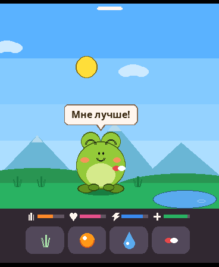</a> |  |
| **10. Пип** Самостоятельный режим «17:00» |  | <a href="img/medvegoshi-ru/gallery/pip-settings.png">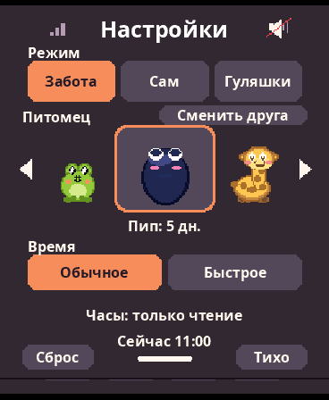</a> |
| **10. Жирафик** Взрослый на прогулке «Поле 1» |  | <a href="img/medvegoshi-ru/gallery/girafa-settings.png">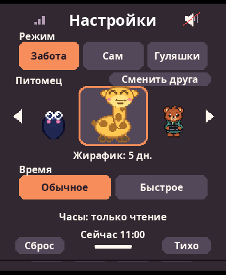</a> |
| **11. Бйорни** Вечерние гуляшки «Поле 1» |  | <a href="img/medvegoshi-ru/gallery/bjorni-settings.png">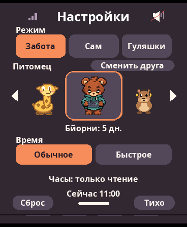</a> |

## Бйорни крупным планом

| Забота | Кормление | Ночной сон |
|:---:|:---:|:---:|
|  |  |  |
| «Друг вернулся!» | Бйорни подносит ягоду ко рту | Бйорни задремал с клавиатурой |

| Гуляшки | Смена друга |
|:---:|:---:|
|  | <a href="img/medvegoshi-ru/bjorni-switch-confirm.png">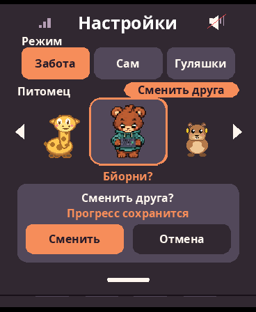</a> |
| «Поле 1»: ходьба вправо | «Сменить друга? Прогресс сохранится» |

### Как переснять

В ветке [русской версии](https://github.com/Medvedolog/medvegoshi/tree/feature/russian-game-ui) запусти <code>python -m ports.render_zoo_gallery --out build/zoo-gallery</code>. Эмулятор использует временные сохранения и не обращается к физической плате. [Описание сцен и контрольные суммы](img/medvegoshi-ru/gallery/gallery.json).
