# Скриншоты MedveGoshi

[← На главную](../README.md) · [Карамелька в движении](#карамелька-в-движении) · [Рыська крупным планом](#рыська-крупным-планом) · [Фенек крупным планом](#фенек-крупным-планом) · [Бйорни крупным планом](#бйорни-крупным-планом)

Все кадры сняты в эмуляторе **AMOLED V1, 368×448** из русской сборки [PR #2](https://github.com/Medvedolog/medvegoshi/pull/2). Реплики, часы и метки полей набраны пропорциональным Noto Sans Bold в родном разрешении, как и меню. В крупном режиме сцена рисуется прямо в 368×435 внутри панели, без растягивания кадра 240×284. Карамелька получила новый облик щенка: длинные ушки, светлая мордочка, карамельные тени и мелкие блики на AMOLED. Слева игровой момент, справа тот же питомец в меню «Настройки». Подписи поясняют сцену; реплики в кавычках взяты с экрана. Нажми на кадр, чтобы увеличить.

| Питомец и сцена | В игре | В настройках |
|---|:---:|:---:|
| **1. Капи** Яйцо «Я в яйце!» · «Согрей меня!» |  | <a href="img/medvegoshi-ru/gallery/capi-settings.png">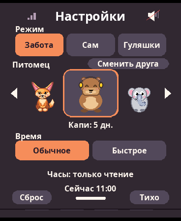</a> |
| **2. Слон** Купание «Как приятно!» | <a href="img/medvegoshi-ru/gallery/elefante-play.png">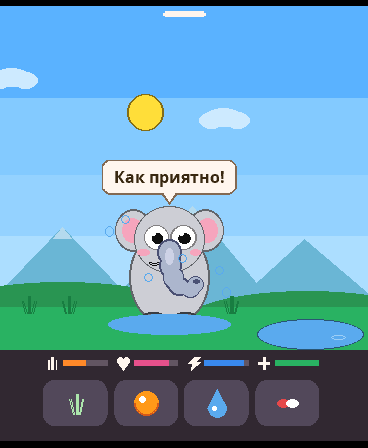</a> |  |
| **3. Утка** Ночь и сон «Пойду спать...» |  |  |
| **4. Осьминог** Утренняя прогулка «Поле 1» | <a href="img/medvegoshi-ru/gallery/polvo-play.png">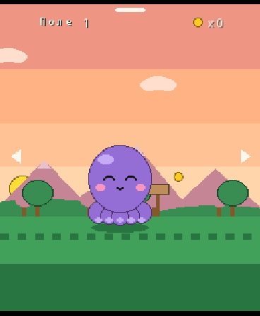</a> |  |
| **5. Попугай** Осмотр «Я не болею!» | <a href="img/medvegoshi-ru/gallery/calopsita-play.png">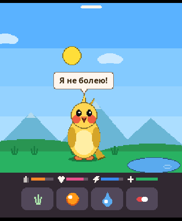</a> | <a href="img/medvegoshi-ru/gallery/calopsita-settings.png">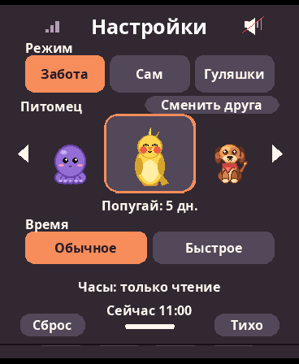</a> |
| **6. Карамелька** Кормление после обеда «Я уже сыт!» | <a href="img/medvegoshi-ru/gallery/cachorro-play.png">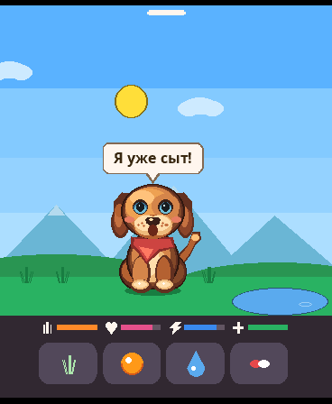</a> |  |
| **7. Кот** Котёнок «Я не болею!» | <a href="img/medvegoshi-ru/gallery/gato-play.png">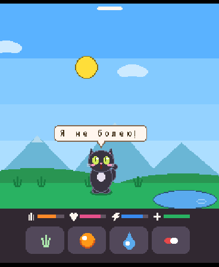</a> | <a href="img/medvegoshi-ru/gallery/gato-settings.png">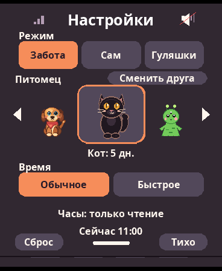</a> |
| **8. Пришелец** Прыжок на прогулке «Поле 1» |  |  |
| **9. Лягушонок** Лекарство «Мне лучше!» |  | <a href="img/medvegoshi-ru/gallery/sapinho-settings.png">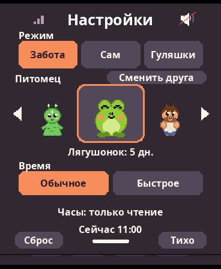</a> |
| **10. Пип** Самостоятельный режим «17:00» | <a href="img/medvegoshi-ru/gallery/pip-play.png">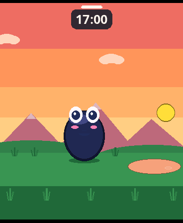</a> |  |
| **11. Жирафик** Взрослый на прогулке «Поле 1» | <a href="img/medvegoshi-ru/gallery/girafa-play.png">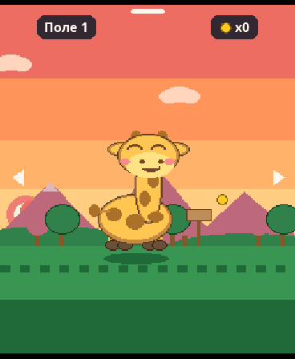</a> |  |
| **12. Бйорни** Вечерние гуляшки «Поле 1» | <a href="img/medvegoshi-ru/gallery/bjorni-play.png">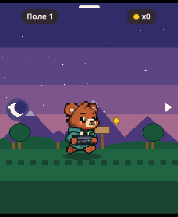</a> |  |
| **13. Рыська** Дневной уход | <a href="img/medvegoshi-ru/gallery/ryska-play.png">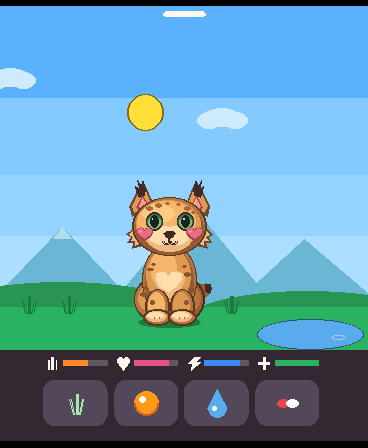</a> | <a href="img/medvegoshi-ru/gallery/ryska-settings.png">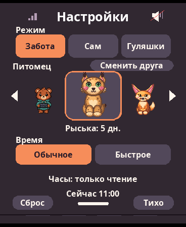</a> |
| **14. Фенек** Знакомство | <a href="img/medvegoshi-ru/gallery/fennec-play.png">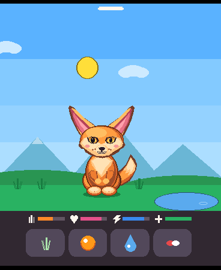</a> | <a href="img/medvegoshi-ru/gallery/fennec-settings.png">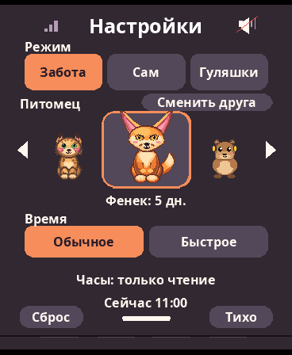</a> |

## Рыська крупным планом

Круглая мордочка, сердечки на щёчках и большое сердце на груди перенесены из детского рисунка. Песочная шерсть, пятнышки, тёмные кисточки на ушах и короткий хвост отличают Рыську от обычного котёнка. На картинке три позы настоящего игрового спрайта.

[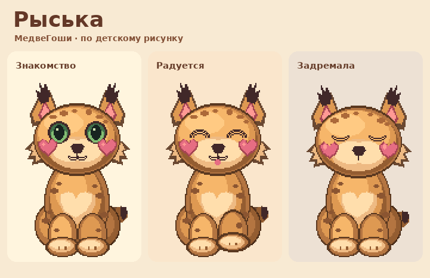](img/medvegoshi-ru/ryska-preview.png)

## Фенек крупным планом

По детскому рисунку сохранили сложенные перед собой лапки и кавайное выражение. По фотографии фенека уточнили силуэт: уши широко расходятся, мордочка сужается книзу, а жёлтые миндалевидные глаза смотрят из-под тёмного ободка. Шерсть осталась рыжей, хвост пушистым.

[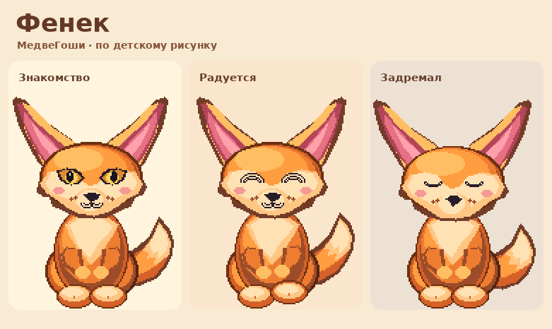](img/medvegoshi-ru/fennec-preview.png)

## Карамелька в движении

Щенок виляет хвостом в покое, жуёт во время кормления, радуется ласке и укладывает хвост во сне. На ходу поднимает лапки по очереди, а в прыжке ушки слегка подлетают. Это кадры из эмулятора, не отдельная рисованная анимация.

[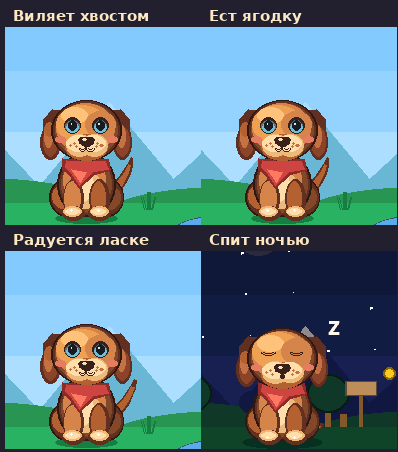](img/medvegoshi-ru/caramel-motion.gif)

## Бйорни крупным планом

| Забота | Кормление | Ночной сон |
|:---:|:---:|:---:|
| <a href="img/medvegoshi-ru/bjorni-care.png">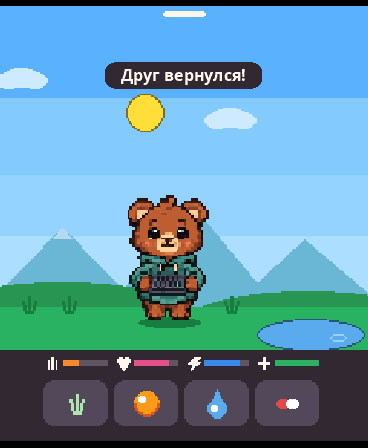</a> |  | <a href="img/medvegoshi-ru/bjorni-sleeping.png">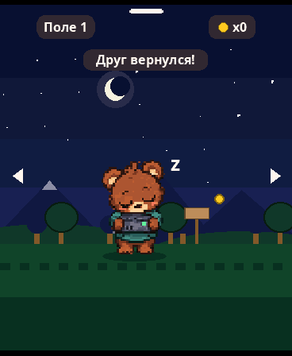</a> |
| «Друг вернулся!» | Бйорни подносит ягоду ко рту | Бйорни задремал с клавиатурой |

| Гуляшки | Смена друга |
|:---:|:---:|
| <a href="img/medvegoshi-ru/bjorni-gulyashki.png">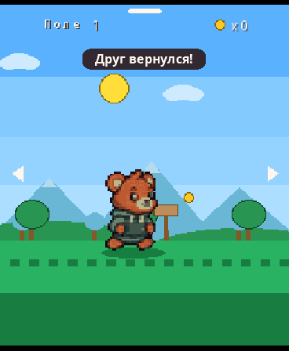</a> |  |
| «Поле 1»: ходьба вправо | «Сменить друга? Прогресс сохранится» |

## Как питомцы кувыркаются

Карамелька, Кот, Капи и Слон в пяти фазах кувырка. Весь спрайт поворачивается одним слоем: глаза, лапы, уши, хвост и хобот остаются на месте относительно тела.

[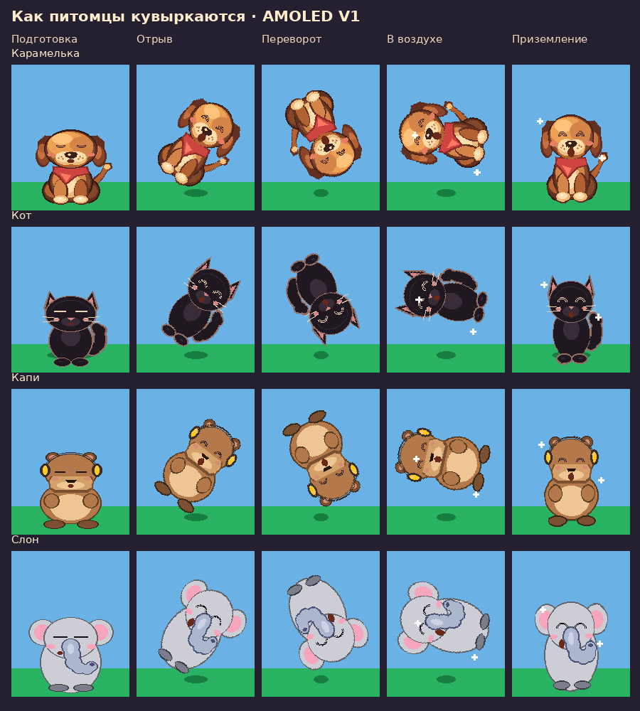](img/medvegoshi-ru/pets-turn.png)

### Как переснять

В ветке [русской версии](https://github.com/Medvedolog/medvegoshi/tree/feature/russian-game-ui) запусти <code>python -m ports.render_zoo_gallery --out build/zoo-gallery</code>. Эмулятор использует временные сохранения и не обращается к физической плате. [Описание сцен и контрольные суммы](img/medvegoshi-ru/gallery/gallery.json).
